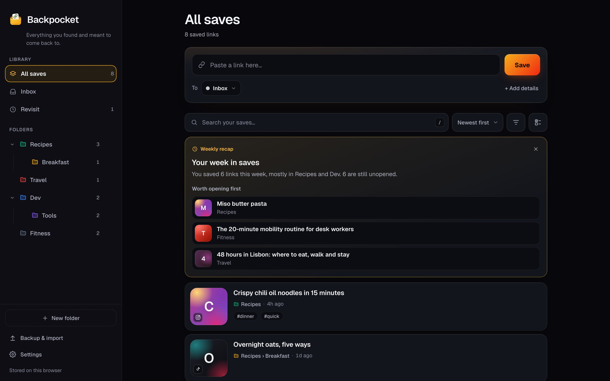
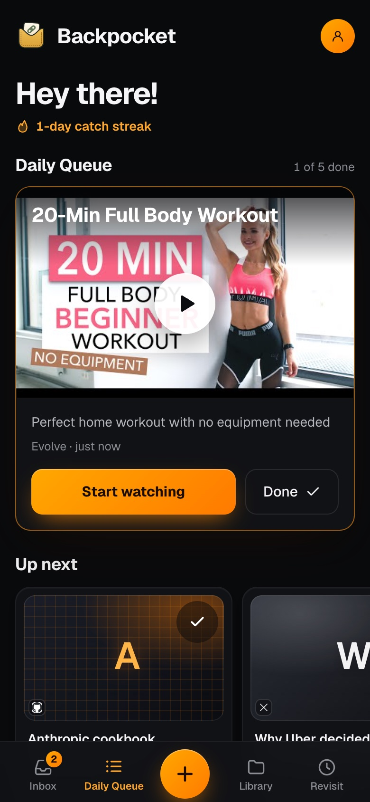

# Backpocket

**Stop losing the good stuff.** That recipe reel, the 20-minute workout, the thread you swore you'd read later. Backpocket catches everything you find on Instagram, TikTok, YouTube, X and the rest of the web, keeps it tidy, and actually gets you to come back to it.

Free, private by default, and it installs like an app in a few seconds: **<https://mohammeddev07.github.io/Backpocket/>**

<p align="center">
  
  &nbsp;
  
</p>

## Why people use it

**Save from anywhere, in one tap.** Share straight from Instagram, TikTok, YouTube, Facebook or X on Android. Use a ready-to-go Shortcut on iPhone, or a bookmarklet on your computer. Or just paste a link anywhere in the app. No account needed.

**It organises itself.** Nested, colour-coded folders keep things neat, and anything you don't file lands in your Inbox. Turn on AI and it files new saves for you, writes a clean title and adds tags, without ever overriding what you typed.

**You'll actually come back to it.** This is the part other bookmark apps forget:
- **Cheeky reminders.** Opt in and Backpocket nudges you about saves you never opened, food-delivery style: *"Order up! "One-pan lemon orzo" has been ready for 9 days. Come and get it."* With AI on, each nudge is written for that link and picks the forgotten save that matches what you're into lately.
- **A weekly recap.** Once a week you get a short summary of what you saved and the three things most worth opening first.
- **Daily Queue.** Five saves a day to actually get through: one to focus on, four up next. Mark them done to keep your catch streak going.
- **Revisit.** One tap shows everything you saved over a week ago and never opened, with a shuffle button for when you can't decide.

**Find anything in seconds.** Instant search across titles, notes, captions, tags and folders. With AI, search by meaning ("that chess opening video", "tiktok from last week"). On any save, **More like this** finds its closest matches, and you get a heads-up when you save something very similar to what you already have.

**Turn a folder into a plan.** Saved ten videos about learning to cook? **Make a plan** turns them into a step-by-step checklist, with every step linked back to the saves it came from.

**Private by default.** Without an account, your saves live only in your browser on your device. Backpocket has no copy of them, and Settings says so plainly. Sign in only if you want sync across devices.

**Looks great, works everywhere.** A calm dark "obsidian" design with warm amber accents, plus a light mode. It works offline, installs on your phone or computer, and is built for real thumbs and real eyes: 44px tap targets, visible keyboard focus, readable contrast and reduced-motion support.

## Get started in 30 seconds

1. Open **<https://mohammeddev07.github.io/Backpocket/>**.
2. Tap **+**, paste a link and tap **Save to Backpocket**. That's it, you're using it.
3. Optional: install it (☰ menu → **Install app**) so it appears in your phone's share sheet.
4. Optional: **Sign in with Google** to sync across devices and unlock AI.
5. Optional: **Settings → Reminders** to get nudged about forgotten saves.

## Everything it does

- **Folders**: nested and colour-tagged, shown as cards in the Library. **Inbox** catches unfiled saves. **Revisit** and **Favorites** (star any save from its menu) are smart views. Saves show as a list or a two-column grid.
- **Beautiful cards**: a real thumbnail when one is available (YouTube, TikTok), otherwise a colourful tile in the platform's colours with the title's first letter. Every card shows the title, folder path, when you saved it and your tags.
- **Unread and done**: opening a link records it; mark things done when you're finished.
- **Tags** with autocomplete.
- **Duplicate detection**: links are normalised (tracking junk like `utm_*`, `igsh` and `si` is stripped, `youtu.be` expanded), so re-saving shows "Already saved in X · Open / Save anyway". With AI on, near-duplicates from different links get flagged too.
- **Search, sort and filters**: instant keyword search, a sort menu (newest, oldest, title, platform), and filters for folder scope, status, platform, tags and dates, shown as removable chips.
- **Bulk select**: move, mark done or delete many at once, with undo.
- **Reminders and weekly recap** (opt-in): in the app on every device. Notifications while the app is closed work in Chrome on Android or a computer once the app is installed.
- **Backup & import**: export a JSON backup or a bookmarks HTML file (the format every browser imports), and import either one.
- **Sync** (signed in): offline-first. Every change saves on the device first and syncs when you're online.
- **AI** (signed in, optional): sort on save, search by meaning, More like this, near-duplicate warnings, smarter reminder picks, AI-written nudges, weekly recap and folder plans. See [AI](#ai).

## Share from other apps

### Android

Once installed from Chrome, Backpocket appears in the Android share sheet.

1. Open the site in Chrome on Android.
2. Open the menu (☰) and tap **Install app**. Or use Chrome's menu (⋮) → **Add to Home screen** → **Install**. Don't pick **Create shortcut**: a shortcut never appears in the share sheet.
3. In Instagram, YouTube, TikTok, Facebook, X (or any app), tap **Share** → **Backpocket**.
4. Backpocket opens with the link filled in and the shared caption kept with it. Pick a folder, add tags if you like, and tap **Save**. Nothing is saved until you tap Save.

If the shared content has no `http(s)` link, Backpocket shows an error under the link field so you can paste the link yourself.

> **Installed Backpocket before share support was added?** Uninstall it (long-press the icon → **Uninstall**, or Chrome → Settings → Apps), then reinstall it from the site. Android only registers share targets at install time. Your saves aren't affected: they live in Chrome's storage for the site, not in the installed app. Don't clear the site's data while doing this.

#### Browser support

| | Chrome | Brave |
|---|---|---|
| App (desktop and Android) | ✅ | ✅ |
| Install as an app | ✅ desktop and Android | ✅ desktop. On Android it's a home-screen shortcut only |
| Appears in the Android share sheet | ✅ | ❌ Brave on Android can't create WebAPKs ([brave-browser#7357](https://github.com/brave/brave-browser/issues/7357)), and Android only registers share targets for WebAPKs |
| Works with Shields / ad blockers on | n/a | ✅ Fonts fall back to system fonts and favicons fall back to platform icons if they're blocked |

To use the share sheet on Android, install Backpocket from **Chrome**, even if Brave is your everyday browser. Each browser keeps its own storage, so saves in Brave don't show up in the Chrome-installed app. Sign in to the same account in both and they sync, or use **Backup & import** to move them across without an account.

#### Backpocket isn't in the share sheet?

1. **Check that it's really installed and not a shortcut.** Open `chrome://webapks` in Chrome on the phone. Backpocket should be listed, with **Manifest URL** ending in `/Backpocket/manifest.webmanifest`.
   - **Not listed:** you have a shortcut (Brave's home-screen icon, or Chrome's **Create shortcut**). Delete it and install from Chrome as above.
   - **Listed, but Manifest URL ends in `manifest.json`:** the install came from an older version of the page. Uninstall it, open the site in Chrome, reload once, then install again.
2. **Open Android's full share sheet.** Instagram, TikTok and X show their own share panel first. Tap **More**, **Share to…** or **Other** to reach Android's list, and scroll it: new apps usually aren't in the top row.
3. **Install from Chrome.** Brave on Android can't register share targets (see above).

### iPhone

iOS doesn't let web apps join the share sheet, so Backpocket uses a free Apple Shortcut instead (no App Store). In the app, open **Settings → Add to iPhone share sheet** for step-by-step instructions that match the current Shortcuts app. Backpocket also suggests this once the first time you open it on an iPhone. The Shortcut opens `https://mohammeddev07.github.io/Backpocket/?url=<link>`, which goes through the same path as an Android share. A one-tap "Add Shortcut" link can be turned on by setting `IOS_SHORTCUT_URL` in `src/config.ts`.

The Shortcut opens **Safari**, not the home-screen app, and iOS keeps their storage separate. Sign in to the same account in both so saves made through the Shortcut sync to the home-screen app.

### Desktop

**Settings → Save from other apps** has a bookmarklet. Drag it to your bookmarks bar, then click it on any page to save that page. Pasting a link anywhere in the app (outside a text field) opens it in the Save sheet, **N** starts a new save, and **/** jumps to search.

## Reminders and weekly recap

Turn them on in **Settings → Reminders**. At most one nudge a day, and **Send a test nudge** shows you one right away.

- **Which link:** a save you never opened, haven't marked done, and saved at least 7 days ago. With AI on, it's the one closest to what you've saved recently; otherwise the pick rotates daily. Links you were nudged about in the last week are skipped.
- **What it says:** with AI on, a short joke written for that link. Otherwise one of the built-in lines, with special ones for YouTube, Instagram, TikTok, X and Facebook.
- **When:** in the app, a toast when you open or return to Backpocket. In the background, a notification about once a day when the app is installed from Chrome on Android or a computer, notifications are allowed, and Chrome grants background sync (it decides based on how much you use the app). iPhone web apps can't do background notifications without a push server, so iPhone gets the in-app nudge only.
- **Weekly recap:** a card at the top of All saves on the first open 7+ days after the last one, for weeks with at least 3 saves. AI users get a written summary and three picks; everyone else gets the numbers ("You saved 14 links this week, mostly in Recipes and Travel. 3 are still unopened."). With reminders on, the recap is that day's nudge and can also arrive as a notification.

## AI

AI is optional and needs a signed-in account. Guests get keyword search and everything else except AI. One switch in Settings turns it all off.

- **Sort on save.** Saving never waits for AI: the link saves right away, then Gemini looks at the link, caption, note and your folder tree. If it's confident (≥ 0.8) and the folder exists, the link moves there with a toast ("Moved to Job › Interview · Undo · Change"). Otherwise the card shows a suggestion you can accept or reject. If you picked a folder yourself, AI never moves the link. It only fills in a title or tags when you left them empty.
- **Search by meaning.** Keyword results appear as you type. Press Enter or tap **Ask** to search by meaning. Words like "tiktok" or "last week" become filters, and if semantic search fails you get the keyword results instead.
- **More like this** (card ⋯ menu) and **near-duplicate warnings** (shortly after a save syncs) use the embeddings Backpocket already stores. They're database lookups, not AI calls.
- **Smarter reminder picks** also come from embeddings: forgotten saves ranked by how close they are to your recent saves.
- **AI-written nudges**: one short call per nudge, prepared ahead of time so background notifications can use it too.
- **Weekly recap**: one call a week writes the summary and picks.
- **Plans.** In a folder with at least two links, **Make a plan** turns them into a 5–15 step checklist. Each step links back to the saves it came from. Ticks sync, and you can regenerate, copy, share or delete a plan.

### Who pays for it

| Account | How AI calls run |
|---|---|
| Guest | No AI. The app shows "Sign in to use AI". |
| Signed in and on the allowlist | Through the `ai` Supabase Edge Function, using the project's Gemini key. |
| Signed in, not on the allowlist | The app offers **Use your own free Gemini key** (from [Google AI Studio](https://aistudio.google.com/apikey)). The key stays in your browser, and calls go straight from the browser to Google, never through Backpocket's server or its quota. |

The model is Gemini 3.5 Flash-Lite with the lowest thinking level and structured JSON output. Embeddings use `gemini-embedding-2` at 768 dimensions. Both kinds of access share the same prompts, schemas and validation (`supabase/functions/_shared/`), so they behave the same.

Rate limits are token buckets in Postgres, so a burst across a minute boundary can't get around them. Each user gets 5 requests at once, then one every 6 seconds, up to 150 a day. A global bucket and a global daily cap keep all users together under the free tier. Going over returns HTTP 429 with `Retry-After`, and the app shows "Slow down, try again in Xs". Bring-your-own-key users get the same limits in the browser, to protect their own quota. Costs per action (sort 1, search 1, embed 1, nudge 1, recap 2, plan 3) and every threshold are in `supabase/functions/_shared/config.ts`.

## Privacy

- **Guests:** everything stays in your browser. Nothing is sent to a Backpocket server, because guests never talk to one. Settings shows a plain "Your data stays on your device" notice.
- **Signed in:** your folders, links and plans sync to a Supabase database (settings stay on the device), and the Settings notice says so. Row-level security means each account can only read its own rows.
- **AI:** "AI features send the link, its caption and your note to Google Gemini." This note is shown in Settings and the first time you use AI. AI-written nudges and recaps send the titles, platforms and folder names of the saves involved.
- **Your own Gemini key** is stored only on that device (`localStorage`) and is only ever sent to Google.
- **Third parties the page talks to:** Google Fonts, Google's favicon service, and YouTube/TikTok oEmbed for thumbnails and titles. **Settings → Use local icons only** turns off the favicon, thumbnail and title lookups, so the links you save are never sent to them.
- **Deleting your account** (Settings → Delete my account and cloud data) removes the account and all its cloud rows. You can choose to keep a local copy on the device.
- The website bundle never contains the Gemini key. The deploy workflow fails if a Google API key shows up in `dist/`.

## Data

**On the device**, everything lives in the IndexedDB database `backpocket`:

| Store | Holds |
|---|---|
| `folders` | id, parentId, name, color, isSystem (Inbox), position, timestamps |
| `links` | id, folderId, url, platform, title, note, sharedText (the shared caption), thumbnailUrl, tags, status, openedAt, aiMeta, timestamps |
| `plans` | id, folderId, title, summary, items (`{text, done, linkIds}`), timestamps |
| `meta` | settings, schema version, sync cursors, and reminder state (`nudgeAt`, `nudgeNext`, `nudgeHistory`, `recap`, `recapNotifiedAt`) |
| `outbox` | rows changed locally that haven't been pushed to Supabase yet |

Deletes are soft (`deletedAt`) so they can sync. A few small things stay in `localStorage`: `backpocket_theme` (read before first paint), `backpocket-auth` (the Supabase session), and `backpocket_gemini_key` plus its rate-limit counters if you bring your own key.

**Upgrading from v1:** on first load, v2 copies everything from the old `localStorage` key `backpocket_data_v1` into IndexedDB. Links at the root move into Inbox and every id becomes a UUID. The old key is left untouched, and a raw copy is also kept as `backpocket_data_v1_backup`.

**In the cloud** (signed in), the Supabase tables `folders`, `links` and `plans` mirror the local stores, plus an `embedding vector(768)` column on `links`. Sync pulls rows changed since the last sync and pushes the outbox. If two devices edit the same row, the last write wins. Sync runs on load, when the app regains focus, when it comes back online, and shortly after each change. Settings (tap your avatar, top right) shows the status at the top ("Synced · 2 min ago" / "Offline - changes will sync"). On first sign-in with local saves, the app offers to upload them, skipping duplicates and merging folders by path.

**Backup & import** exports a JSON backup (`backpocket-backup-YYYY-MM-DD.json`) or a bookmarks HTML file, and imports either one, or a v1 backup. Clearing site data removes the local copy. If you're signed in, it comes back from your account on the next sync. If you're a guest, only a backup brings it back.

## Development

Vite + TypeScript, with no UI framework. Also `idb` for IndexedDB, `@supabase/supabase-js`, a hand-written service worker built with `vite-plugin-pwa` (`injectManifest`), and Vitest. The backend is Supabase (Postgres + pgvector, Auth, Edge Functions in Deno). See [CLAUDE.md](CLAUDE.md) for conventions and gotchas.

```bash
npm i
npm run dev              # http://localhost:5173/Backpocket/ (guest mode unless .env is set)
npm test                 # Vitest
npm run build            # type-check + production build into dist/
npm run preview          # serve dist/ with the service worker on
npm run check:functions  # type-check the Edge Functions with Deno
```

Merging `develop` into `release` runs `.github/workflows/release.yml`, which tests, builds, publishes to GitHub Pages and tags the next version (`v2.0.1`, ...). Cloudflare Pages builds the same branch on its own. To roll back GitHub Pages, run that workflow by hand with an older tag; it waits for approval. Roll back Cloudflare from its dashboard (Deployments, Rollback). Backend changes deploy separately:

```bash
npx supabase db push               # apply new migrations
npx supabase functions deploy ai   # redeploy the AI Edge Function
```

```
src/
  main.ts, actions.ts, config.ts, platform.ts, sw.ts
  styles/   app.css: the whole design system (tokens for light + dark, then components)
  data/     IndexedDB store, v1 migration, sync, backup, URL normalisation, reminders (nudge.ts), weekly recap (recap.ts)
  cloud/    Supabase client and auth
  ai/       Edge Function client, bring-your-own-key client, sort on save, search, embeddings, related.ts
  search/   keyword filters and query parsing
  share/    share-target URL extraction (+ tests against the v1 code)
  ui/       tab bar, settings page, library, queue, list, sheets, modals, settings, reminders, recap
public/     manifest.webmanifest, icons/ (all rendered from icons/mark.svg)
supabase/
  migrations/           schema, RLS, pgvector, rate limits, match_links, related_links, revisit_picks
  functions/ai/         classify / search / plan / embed / nudge / recap
  functions/delete-account/
  functions/_shared/    config, prompts and schemas shared with the browser
```

### How the share target works

- `public/manifest.webmanifest` declares a GET `share_target` pointing at `./index.html`, with `title`, `text` and `url` params. All paths are relative, so it works under `/Backpocket/` without hardcoding the repo name.
- Apps are inconsistent about where they put the link. Chrome maps Android's shared text to `text`, so most social apps send the link there, sometimes inside a caption ("Check out … https://vm.tiktok.com/…"). `src/share/extractSharedUrl.ts` checks `url`, then `text`, then `title`, and takes the first valid `http`/`https` URL. It drops trailing punctuation but keeps balanced parentheses. The iPhone Shortcut and the bookmarklet use the same `?url=` path.
- Once the form is filled in, the share params are removed from the address bar with `history.replaceState`, so a reload or Back doesn't apply them again.
- The service worker (`src/sw.ts`, built to `sw.js`, the same URL as v1) fetches the page and manifest from the network first and uses the cache only offline, so the first visit after a deploy never installs last release's manifest. Page loads are cached by path, ignoring the query string, so a share launch still opens offline. Fonts and YouTube/TikTok thumbnails are cached at runtime. Supabase, Gemini and oEmbed calls are never served from the cache. The cache name is derived from the build's file list, so every deploy refreshes the offline copy automatically. The same worker handles the background reminder (`periodicsync`) and notification taps.
- Icons are in `public/icons/`, all rendered from `mark.svg` (also `#brand-mark` in `index.html`). `favicon.svg` is the browser-tab icon: a light tile on light systems, a dark tile on dark ones. Home-screen icons can't switch with the theme, so the PNGs use the dark tile: `icon-192.png` and `icon-512.png` (`purpose: any`), plus `icon-512-maskable.png`, which keeps the artwork inside the 80% safe zone on an opaque background so Android's adaptive-icon masks don't clip it.
